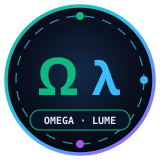

<h1>
  
  Omega Sovereign — Engineering Projects &amp; Roadmap
</h1>
 

## Active Engineering Tracks (`v1.1.0`)

| Track ID | Project Name | Status | Deliverables |
| :--- | :--- | :---: | :--- |
| **OS-01** | **6-Pillar Sovereign Core (`omega_sovereign.src`)** | **Completed ✓** | `QF_LIA` proofs, Perceus zero-GC memory, `.cert` attestation |
| **OS-02** | **Native Win64 PE32+ GUI (`OmegaSovereign_GUI.exe`)** | **Completed ✓** | `33,792B` GUI with Lumi `RT_ICON`, `1366px` full-width bottom panes, `WS_CLIPSIBLINGS \| WS_THICKFRAME` |
| **OS-03** | **P33 Anti-REA Binary Shield (`OmegaSovereign_P33.exe`)** | **Completed ✓** | `.data` encrypted at rest with `XOR k=178` + self-healing MBA prologue |
| **OS-04** | **Universal Chameleon 9-Ecosystem Polyglot Bridge** | **Completed ✓** | `[I0003]` `unverified[T] -> verified[T]` across C, Rust, Python DLPack, Node, Go, JVM, .NET, SQL, OpenAPI |
| **OS-05** | **Local Multimodal AI & Silicon Targets** | **Completed ✓** | Ollama router (`Gemma 4 E2B` + `Ministral 3 3B`), CUDA PTX 8.0, SPIR-V 1.6, Verilog RTL |
