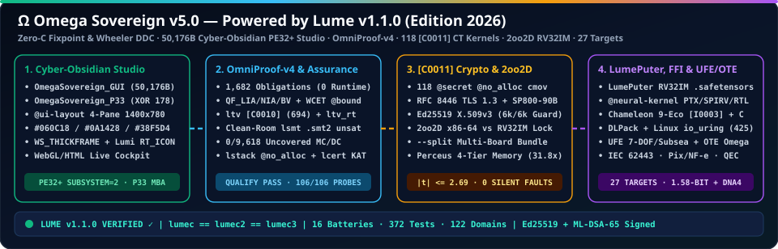
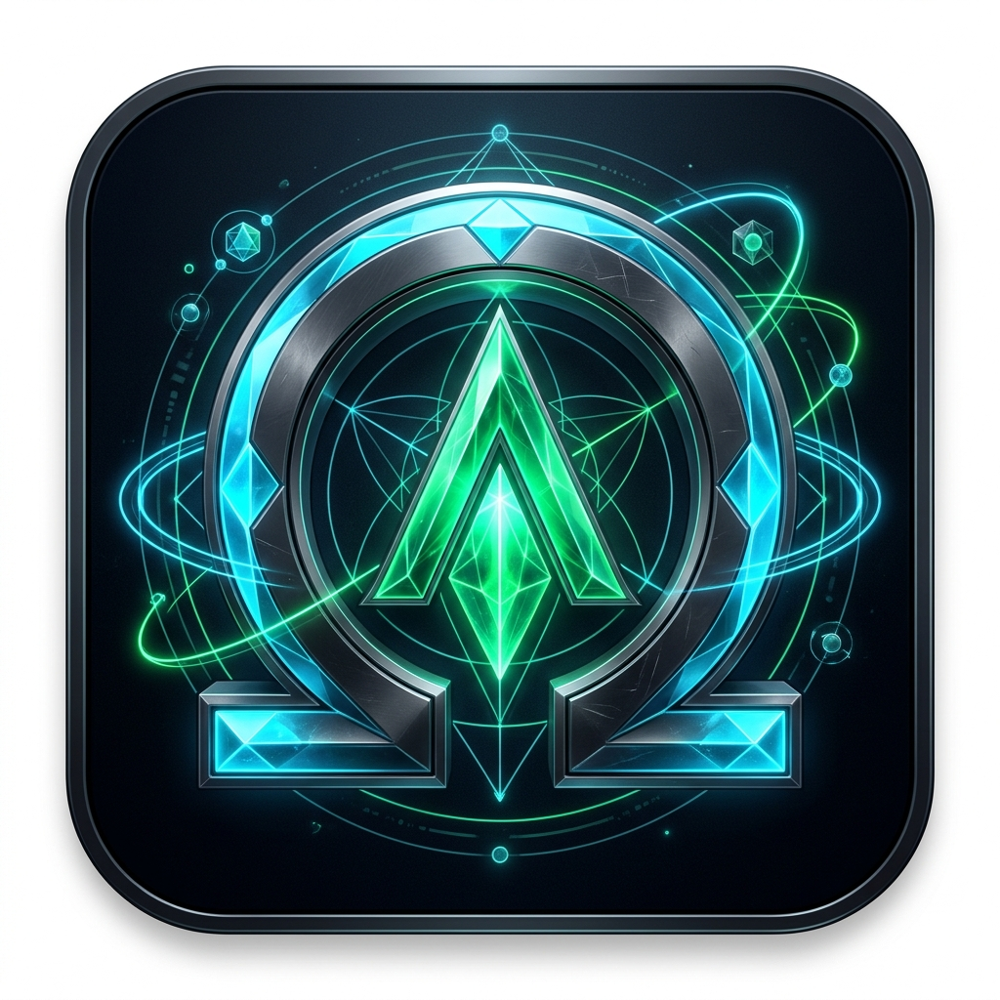

<h1>
  
  Omega Sovereign <code>v5.0</code> — Flagship Full-Stack Sovereign Command Center, Binary-Assurance Studio &amp; Multi-Target AI Workstation (<code>100%</code> Native Lume <code>v1.1.0</code>, Edition 2026)
</h1>

**`OmniProof-v4` + `lcert --check-source` Formal Verification · Symbolic Binary Assurance (`ltv` / `ltv_rt` / `lsmt` / `0`-Uncovered MC/DC / `lstack`) · `[C0011]` Constant-Time Crypto, Ed25519 X.509v3 & TLS 1.3 · `2oo2D` Clean-Room `RV32IM` Lockstep · `50,176 B` Win64 `PE32+` Cyber-Obsidian Studio · 9-Ecosystem Chameleon FFI · In-Weights `LumePuter` & Multi-Target Silicon/Quantum Synthesis**

<br clear="left"/>

<div align="center">

[](https://github.com/OmegaSoftDLL/Lume)
[](https://github.com/OmegaSoftDLL/Lume)
[](omega_sovereign.cert)
[](#03-post-codegen-symbolic-binary-assurance-ltv-ltv_rt-lsmt-lmcdc-lstack)
[](#04-c0011-constant-time-cryptography-ed25519-x509v3-pki-nist-sp-800-90b-entropy--authenticated-tls-13)
[](#05-2oo2d-clean-room-rv32im-safety-envelope---split-4-tier-atomic-memory-318x--linear-concurrency)
[](OmegaSovereign_GUI.exe)
[](LICENSE)

[**English Architecture Manual**](#executive-overview--what-omega-sovereign-v50-is--how-it-is-engineered) · [**12 Sovereign Pillars**](#the-12-sovereign-architectural-pillars-demonstrated-in-v50) · [**8 `.lume` Domain Modules**](#the-8-surface-lume-domain-modules-moduleslume) · [**Repository Structure**](#repository-structure) · [**Quick-Start & Assurance Gates**](#quick-start-native-build--binary-assurance-gate-commands-lume-v110) · [**Manual Institucional Completo em Português (`PT-BR`)**](#manual-institucional-completo-em-português-pt-br) · [**Official Portal**](https://omegasoftdll.github.io/omega-sovereign/) · [**Wiki**](docs/wiki/Home.md) · [**Lume Compiler Repository**](https://github.com/OmegaSoftDLL/Lume)

<br/>



</div>

---

## Executive Overview — What Omega Sovereign `v5.0` Is & How It Is Engineered



**Omega Sovereign (`v5.0`, Edition 2026)** is the flagship full-stack command center, binary-assurance engineering studio, cyber-physical control suite, and local multimodal AI workstation built **100% in native [Lume `v1.1.0`](https://github.com/OmegaSoftDLL/Lume)** — engineered by **Ricardo Bueno ([`@OmegaSoftDLL`](https://github.com/OmegaSoftDLL))** and **Omega DeepTech Systems Inc. (ODSI) / LumeLabs** with **zero lines of C, C++, Rust, C#, Python, or JavaScript toolchain dependencies** and **zero external assemblers, linkers, or resource compilers**.

Omega Sovereign `v5.0` serves as the canonical production reference system proving every capability of the finalized **Lume `v1.1.0`** programming language inside a single, self-verifying codebase:

1. **End-to-End Mathematical & Binary Assurance:** Every invariant in [`omega_sovereign.src`](omega_sovereign.src), [`omega_compute_core.src`](omega_compute_core.src), [`omega_pe64_gui_synth.src`](omega_pe64_gui_synth.src), [`omega_rtc_kernel.src`](omega_rtc_kernel.src), and [`modules/*.lume`](modules) is statically discharged by **`OmniProof-v4`** (`QF_LIA` with Farkas dual witnesses, `QF_NIA` Horner/square-completion, `QF_BV` bit-shifts, relational octagons, `@bound` WCET cycle budgets) and re-verified by Lume's zero-compiler-import proof kernel (**`lcert --check-source`**). Beyond the AST, emitted native binaries and `.smt2` certificates undergo **symbolic machine-code translation validation (`ltv`)**, **runtime integer helper verification (`ltv_rt` `18/18`)**, **clean-room `QF_UFNIA` solving (`lsmt`)**, **native-binary Masking MC/DC (`0` uncovered conditions)**, **exact static worst-case stack byte analysis (`lstack`)**, and **`2oo2D` dual-channel lockstep (`lsafety_envelope`)** against a clean-room `RV32IM` compiler sharing zero functions with `lumec`.
2. **Direct Native Win64 `PE32+` Desktop Studio & P33 Binary Shield:** [`omega_pe64_gui_synth.src`](omega_pe64_gui_synth.src) synthesizes byte-exact Windows x64 `PE32+` Subsystem-2 executables directly from pure Lume: [`OmegaSovereign_GUI.exe`](OmegaSovereign_GUI.exe) (**`50,176` bytes**) and [`OmegaSovereign_P33.exe`](OmegaSovereign_P33.exe) (**`50,208` bytes**, protected at rest by `XOR k=178` `.data` encryption and a self-healing Mixed Boolean-Arithmetic prologue). Both binaries feature a native `GDI32` **Cyber-Obsidian Dark-Neon Studio** (`1400×780`), 4 `WS_THICKFRAME` resizable/scrollable inspection panes governed by `QF_LIA` pixel-conservation laws, embedded 32-bit BGRA **Lumi** `RT_ICON` resources, and instant launch into the interactive HTML5/WebAssembly 3D Cockpit ([`omega_cockpit.html`](omega_cockpit.html)).
3. **Unified Sovereign Computing Stack:** From `[C0011]` branch-free constant-time cryptography (Ed25519 X.509v3 PKI, NIST SP 800-90B entropy, RFC 8446 TLS 1.3), 9-ecosystem `[I0003]` Chameleon polyglot FFI, and in-weights `.safetensors` neural virtual machines (`LumePuter` / `LumePU` / `OpenTPU`) to 1.58-bit local multimodal AI routing, IEC 62443 cyber-physical OT control, Brazilian FinTech (`SEFAZ NF-e` + `BACEN Pix CobV` + Alphanumeric CNPJ), `AEGIS` `STIX 2.1` forensics, CUDA PTX, Vulkan SPIR-V, synthesizable Verilog RTL, `OpenQASM 3.0` + `[[9,1,3]]` Surface-Code QEC, `DNA4` molecular storage, and a `@freestanding` Ring-0 real-time kernel.

> 🇧🇷 **Resumo Executivo em Português (`PT-BR`):** O **Omega Sovereign (`v5.0`, Edição 2026)** é o Command Center soberano full-stack, estúdio nativo de garantia binária e estação de trabalho multimodal de IA construído **100% em [Lume `v1.1.0`](https://github.com/OmegaSoftDLL/Lume) puro** (`Zero C / Zero C++ / Zero Rust / Zero Python / Zero Linker Externo`). Demonstra em um único repositório coeso os **12 Pilares Arquiteturais Soberanos** da Lume `v1.1.0`: compilação auto-hospedada em ponto fixo (`stage2 == stage3` + *Diverse Double-Compilation*), provas formais **`OmniProof-v4`** auditadas por **`lcert --check-source`**, validação simbólica pós-codegen de código de máquina (`ltv`, `ltv_rt` `18/18`, solver *clean-room* `lsmt`, cobertura **MC/DC com `0` condições descobertas** e cálculo estático de pilha `lstack`), criptografia *constant-time* **`[C0011]`** (PKI X.509v3 Ed25519, entropia NIST SP 800-90B e TLS 1.3), envelope de segurança **`2oo2D`** em *lockstep* contra compilador *clean-room* `RV32IM` (`safety_bundle/`), ponte poliglota **Camaleão para 9 ecossistemas (`[I0003]`)**, execução neural em pesos **`.safetensors` (`LumePuter`)**, roteador local de IA de `1,58-bit`, controle ciberfísico IEC 62443, FinTech brasileira (`SEFAZ NF-e`, `Pix CobV`, CNPJ Alfanumérico 2026), síntese de silício/quântica/DNA4 e o estúdio desktop nativo **Win64 `PE32+` Cyber-Obsidian** de **`50.176` bytes** ([`OmegaSovereign_GUI.exe`](OmegaSovereign_GUI.exe)) e **`50.208` bytes** ([`OmegaSovereign_P33.exe`](OmegaSovereign_P33.exe)). Consulte o [**Manual Institucional Completo em Português (`PT-BR`)**](#manual-institucional-completo-em-português-pt-br) abaixo.

<br clear="right"/>

---

## End-to-End Architecture & Mutual Binary Assurance Flow

```mermaid
flowchart TD
    subgraph SRC["1. 100% Native Lume v1.1.0 Source Suite"]
        S1["omega_sovereign.src (12-Pillar Core Engine)"]
        S2["omega_compute_core.src (Numeric, FinTech, SOC & AI Kernels)"]
        S3["omega_pe64_gui_synth.src (Bespoke Win64 PE32+ GUI & P33 Synthesizer)"]
        S4["omega_rtc_kernel.src (@freestanding Ring-0 Real-Time Kernel)"]
        S5["modules/*.lume (8 Surface-Syntax Domain Modules)"]
    end

    subgraph PROVE["2. Compile-Time Formal Verification & Effect/Taint Kernel"]
        P1["OmniProof-v4 Solver (QF_LIA + Farkas Duals | QF_NIA | QF_BV | Octagons)"]
        P2["Resource & Safety Contracts (@bound WCET [V0002] | / pure [E0200] | @no_alloc [E0210])"]
        P3["Constant-Time & FFI Guards (@secret @no_alloc [C0011] | Chameleon [I0003] | Linear [E0305/E0306])"]
        P4["Standalone Proof Kernel (lcert --check-source -> omega_sovereign.cert & omega_compute_core.cert)"]
    end

    subgraph BIN["3. Post-Codegen Symbolic Binary Assurance & 2oo2D Lockstep"]
        B1["lume tv & lume tv-rt (AST-to-Machine Equivalence | [C0010] Machine CT | 18/18 Runtime Helpers)"]
        B2["lume smt-check (Clean-Room lsmt QF_UFNIA Solver -> unsat on omega_compute_core.smt2)"]
        B3["lume mcdc & lume stack (0 Uncovered Masking MC/DC Conditions | Exact Worst-Case Stack Bytes)"]
        B4["lume safety-envelope --split (2oo2D x86_64 Channel A vs Clean-Room RV32IM Channel B -> safety_bundle/)"]
    end

    subgraph OUT["4. Multi-Target Native Binaries, Neural Cartridges & Hardware Artifacts"]
        O1["Win64 PE32+ Desktop Studio (OmegaSovereign_GUI.exe 50,176 B | OmegaSovereign_P33.exe 50,208 B)"]
        O2["Web & Telemetry Cockpit (omega_cockpit.html | omega_sovereign.wasm | omega_web_dom.wasm)"]
        O3["In-Weights Neural VM (omega_compute_core.safetensors | LumePuter RV32IM_Zba | OpenTPU)"]
        O4["Silicon, Quantum, Molecular & Bare-Metal (.ptx | .spvasm | .v RTL | .qasm | .dna4 | .kernel)"]
        O5["9-Ecosystem Chameleon Bridges (chameleon_c_abi.h | .rs | _dlpack.c | .mjs | _openapi.json)"]
    end

    SRC --> PROVE
    P1 --> P4
    P2 --> P4
    P3 --> P4
    PROVE --> BIN
    BIN --> OUT
```



---

## The 12 Sovereign Architectural Pillars Demonstrated in `v5.0`

| Pillar | Primary Sources & Emitted Artifacts | Verified Engineering Guarantee |
| :--- | :--- | :--- |
| **`[01]` Zero-C Compiler, DDC & `PE32+` Synthesis** | [`omega_sovereign.src`](omega_sovereign.src), [`omega_pe64_gui_synth.src`](omega_pe64_gui_synth.src), [`OmegaSovereign_GUI.exe`](OmegaSovereign_GUI.exe), [`OmegaSovereign_P33.exe`](OmegaSovereign_P33.exe) | Bit-identical triple-bootstrap fixpoint (`lumec == lumec2 == lumec3`), Wheeler DDC (`cc` vs `clang`), `50,176 B` Win64 GUI & `50,208 B` P33 MBA-shielded GUI |
| **`[02]` `OmniProof-v4` & `lcert --check-source`** | [`omega_sovereign.cert`](omega_sovereign.cert), [`omega_compute_core.cert`](omega_compute_core.cert) | `QF_LIA`, `QF_NIA` (`x * x >= 0`), `QF_BV` shifts, octagons, `@bound` WCET (`[V0002]`), `/ pure` (`[E0200]`), `@no_alloc` (`[E0210]`), SHA-256 + AST-bound standalone certificates |
| **`[03]` Symbolic Binary Assurance Suite** | [`omega_compute_core.smt2`](omega_compute_core.smt2), [`omega_linux_elf`](omega_linux_elf) | `ltv` 1-to-1 AST-to-machine branch correlation & `[C0010]` CT check, `ltv_rt` (`18/18` helpers), clean-room `lsmt` `unsat`, `lmcdc` (`0` uncovered MC/DC), `lstack` byte bounds |
| **`[04]` `[C0011]` CT Crypto, X.509v3 & TLS 1.3** | [`modules/constant_time_crypto_x509.lume`](modules/constant_time_crypto_x509.lume) | Branch-free `@secret @no_alloc` kernels (`cmov`), SHA-256/512, HMAC, HKDF, ChaCha20-Poly1305, X25519, Ed25519, DER/PEM X.509v3 chains, SP 800-90B entropy, RFC 8446 TLS 1.3 |
| **`[05]` `2oo2D` `RV32IM` Envelope, 4-Tier Memory & Concurrency** | [`modules/triad_safety_envelope.lume`](modules/triad_safety_envelope.lume), [`safety_bundle/manifest.json`](safety_bundle/manifest.json) | Dual-channel x86-64 vs clean-room `RV32IM` (`0` shared compiler fns), `0 B` heap 63-bit ints & `0..7 B` SSO, Perceus reuse, `LZ1` compactor (`31.8×`), linear channels (`[E0305]`), lock ranks (`[E0306]`) |
| **`[06]` Chameleon 9-Ecosystem FFI, `--preprocess` & `io_uring`** | [`chameleon_c_abi.h`](chameleon_c_abi.h), [`chameleon_rust_ffi.rs`](chameleon_rust_ffi.rs), [`chameleon_python_dlpack.c`](chameleon_python_dlpack.c), [`chameleon_node_wasm.mjs`](chameleon_node_wasm.mjs), [`chameleon_sql_openapi.json`](chameleon_sql_openapi.json) | Fail-closed `[I0003]` `unverified[T] -> verified[T]` across C/C++, Rust, Python DLPack zero-copy, Node/WASM, Go, Java JNI, .NET NativeAOT, SQL, OpenAPI 3.1 + C preprocessor & Linux `io_uring` |
| **`[07]` `LumePuter` In-Weights Neural VM & `OpenTPU`** | [`omega_compute_core.safetensors`](omega_compute_core.safetensors), [`omega_compute_core.src`](omega_compute_core.src) | Compiles verified Lume functions into `.safetensors` transformer weights (`RV32IM_Zba`), exact SwiGLU ReLU gates, RMSNorm ballast guards, Gated DeltaNet RAM, in-weights `lcert`, `OpenTPU` MACs |
| **`[08]` Local Multimodal & 1.58-Bit Sovereign AI** | [`modules/llm_hybrid_router.lume`](modules/llm_hybrid_router.lume), [`omega_sovereign.src`](omega_sovereign.src) | 3-tier airgap-safe router (`QF_LIA` Prover -> `Bonsai` 1-bit / `BitNet` 1.58-bit / `Gemma 4 E2B` / `Ministral 3 3B` -> Frontier), `Liquid LFM3` 24 kHz audio, `Colibri` MoE SSD guard, `VKPromos` CEGIS |
| **`[09]` Cyber-Physical `UFE`, Singularity $\Omega$ & IEC 62443** | [`modules/cyber_physical_ufe_ote_mesh.lume`](modules/cyber_physical_ufe_ote_mesh.lume) | 7-DOF damped-least-squares robotics, IAPWS-IF97 steam thermodynamics, subsea catenary/VIV/well-kill, Singularity margin ($\tau_{\max} = T_m/4$), Bayesian SPC/CUSUM, IEC 62443 `L0..L4` + `L3.5` DMZ, Raft P2P |
| **`[10]` Sovereign Brazilian FinTech & `AEGIS` Forensics** | [`modules/fintech_pix_nfe_ledger.lume`](modules/fintech_pix_nfe_ledger.lume), [`omega_compute_core.src`](omega_compute_core.src) | Exact cent/decimal `SEFAZ NF-e` (`vNF`, `ICMS DIFAL + FCP`), `BACEN Pix CobV` conservation, `Modulo-11`, RFB/SERPRO July 2026 Alphanumeric CNPJ (`ord(ch) - 48`), double-entry ledger, `STIX 2.1` & binary magic SOC |
| **`[11]` Frontier Silicon, `DNA4`, Quantum QEC & Ring-0** | [`omega_ai_kernel.ptx`](omega_ai_kernel.ptx), [`omega_ai_kernel.spvasm`](omega_ai_kernel.spvasm), [`omega_neural_autodiff.v`](omega_neural_autodiff.v), [`omega_genome_storage.dna4`](omega_genome_storage.dna4), [`omega_quantum_bell.qasm`](omega_quantum_bell.qasm), [`omega_rtc.kernel`](omega_rtc.kernel) | 3-way `@neural-kernel` autodiff equivalence (`CUDA PTX` == `Vulkan SPIR-V` == `Verilog RTL`), homopolymer-free `DNA4`, `OpenQASM 3.0` + `[[9,1,3]]` Surface-Code QEC, `@freestanding` MBR kernel, 0ms CEGIS |
| **`[12]` `@ui-layout` Win64 Studio, Verified Stdlib & Triad** | [`omega_ui_layout_manifest.json`](omega_ui_layout_manifest.json), [`omega_cockpit.html`](omega_cockpit.html), [`omega_sovereign_triad_capsule.json`](omega_sovereign_triad_capsule.json) | Cyber-Obsidian `GDI32` dark-neon palette (`#060C18` / `#0A1428` / `#111F3D` / `#38F5D4` / `#FFBD38`), `ui_split_conservation_law`, verified `Vec[T]`/`Map[K,V]`/`std_clamp`, 3D Cockpit & sub-100ms P2P Triad sentinel |

---

### `[01]` Self-Hosted Zero-C Compiler, Wheeler DDC & Native `PE32+` Synthesis
Omega Sovereign `v5.0` is compiled exclusively by Lume's self-hosted native compiler (`lumec == lumec2 == lumec3` bit-identical triple-bootstrap fixpoint, verified via David A. Wheeler's Diverse Double-Compilation across independent `cc` and `clang` seed builds with `0` byte divergence). Rather than invoking `cl.exe`, `link.exe`, or `rc.exe`, [`omega_pe64_gui_synth.src`](omega_pe64_gui_synth.src) directly synthesizes all COFF/PE32+ headers (`1,024 B`), x86-64 `.text` machine code (`8,192 B` at RVA `0x1000`), `.idata` Import Address Tables for `KERNEL32.dll`, `USER32.dll`, `GDI32.dll`, `COMDLG32.dll`, and `SHELL32.dll` (`4,096 B` at RVA `0x3000`), `.data` inspection slots (`32,768 B` at RVA `0x4000`), and `.rsrc` icon/DPI-manifest directories (`4,096 B` at RVA `0xC000`):
- **[`OmegaSovereign_GUI.exe`](OmegaSovereign_GUI.exe) (`50,176` bytes):** Standalone Windows x64 GUI Subsystem-2 workstation studio.
- **[`OmegaSovereign_P33.exe`](OmegaSovereign_P33.exe) (`50,208` bytes):** Anti-reverse-engineering hardened binary that encrypts active `.data` payloads on disk with `XOR k=178 (0xB2)`, executes a self-healing Mixed Boolean-Arithmetic (`MBA`) decryption prologue at entry (`0x401000`) and `WM_CREATE`, and appends a `32`-byte cryptographic `LUME_SEAL` footer.

### `[02]` `OmniProof-v4` Multi-Theory Theorem Prover & `lcert --check-source` AST Binding
All domain engines enforce compile-time `requires`, `ensures`, `invariant`, and `law` obligations solved by **`OmniProof-v4`** without external solver dependencies during compilation:
- **Multi-Theory Reasoning:** Combines Fourier-Motzkin variable elimination, integer cutting planes, and Farkas dual witnesses (`QF_LIA`), Horner/Bernstein polynomial envelopes and square-completion (`QF_NIA`, proving nonlinear laws such as `x * x >= 0`), exact bit-shift reasoning (`QF_BV`), relational octagons (`±x ± y <= c`), and lexicographic termination rankings.
- **Effect & Resource Contracts:** Enforces `@bound(cycles: N)` static Worst-Case Execution Time (`[V0002]`), `/ pure` referential transparency (`[E0200]`), and `@no_alloc` zero-GC real-time execution (`[E0210]`).
- **Independent Proof Kernel (`lcert`):** Standalone certificates ([`omega_sovereign.cert`](omega_sovereign.cert) and [`omega_compute_core.cert`](omega_compute_core.cert)) bind every proven obligation to the exact SHA-256 digest and AST structure of the source file (`lume verify-cert --check-source`, enforcing `[K0005]` and `[K0006]`).

### `[03]` Post-Codegen Symbolic Binary Assurance (`ltv`, `ltv_rt`, `lsmt`, `lmcdc`, `lstack`)
Omega Sovereign `v5.0` extends verification past source code into the emitted native machine code:
- **Symbolic Translation Validation (`lume tv --exec`):** Disassembles emitted native functions and proves 1-to-1 branch correlation and semantic equivalence against the source AST while checking `[C0010]` machine-level constant-time invariants (confirming zero secret-dependent branches or variable-latency instructions).
- **Runtime Helper Verification (`lume tv-rt`):** Symbolically proves all `18/18` emitted integer runtime helpers across all execution paths.
- **Clean-Room `.smt2` Discharge (`lume smt-check`):** Exports `QF_UFNIA` proof obligations ([`omega_compute_core.smt2`](omega_compute_core.smt2)) and discharges them to `unsat` via Lume's clean-room native solver (`lsmt.src`) as well as external `z3`.
- **Native Masking MC/DC & Worst-Case Stack Bounds (`lume mcdc --exec` & `lume stack --json`):** Executes native binary witnesses to confirm **`0` uncovered Modified Condition/Decision Coverage (MC/DC) conditions** (with `lcert`-backed infeasible-branch pruning) and computes exact static worst-case stack byte consumption across the call graph.

### `[04]` `[C0011]` Constant-Time Cryptography, Ed25519 X.509v3 PKI, NIST SP 800-90B Entropy & Authenticated TLS 1.3
Demonstrated in [`omega_sovereign.src`](omega_sovereign.src) and [`modules/constant_time_crypto_x509.lume`](modules/constant_time_crypto_x509.lume):
- **Branch-Free `@secret @no_alloc` Kernels (`[C0011]`):** Secret-carrying functions (`ct_select`, `ct_eq`, constant-time masks) forbid secret-dependent control flow and heap allocation at compile time, lower directly to conditional moves (`cmov`), and pass `ltv` `[C0010]`, `lstack` (`<= 536 B`), and `dudect` Welch $t$-test leakage thresholds (`|t| < 4.5`).
- **Full Sovereign Cryptographic Suite:** Covers SHA-256/512, HMAC, HKDF, ChaCha20-Poly1305 AEAD, X25519 key agreement, Ed25519 signatures, strict DER/PEM X.509v3 certificate-chain validation (`BasicConstraints`, `KeyUsage`, monotonic validity windows, fail-closed tamper rejection via `lume x509`), NIST SP 800-90B Repetition Count and Adaptive Proportion OS entropy health checks (`lume entropy`), and authenticated RFC 8446 TLS 1.3 transcript/key-schedule verification (`lcrypto_tls`).

### `[05]` `2oo2D` Clean-Room `RV32IM` Safety Envelope (`--split`), 4-Tier Atomic Memory (`31.8×`) & Linear Concurrency
- **`2oo2D` Dual-Channel Diverse Lockstep (`safety_bundle/`):** Critical kernels are compiled simultaneously by `lumec` into native `x86_64` (**Channel A**) and by Lume's clean-room `RV32IM` compiler (`lrv32_lowered.src`, sharing **`0` functions** with `lumec`) into **Channel B**, packaged with [`safety_bundle/manifest.json`](safety_bundle/manifest.json) via `lume safety-envelope --split`. Any single-bit architectural or transient hardware divergence immediately triggers a fail-closed `SafeStateTrip`.
- **4-Tier Atomic Memory (`31.8×` Speedup):** Unboxed 63-bit tagged integers and `0..7`-byte Small-String Optimization (`0 B` heap allocation), compile-time Perceus drop-reuse tokens, 43-size-class segregated Mark & Lazy-Sweep GC, and demand-paged `LZ1` cold-arena compaction.
- **Deadlock- & Race-Free Concurrency:** Enforces affine ownership transfer across linear channels (`[E0305]`) and strictly ascending lock-acquisition rank discipline (`[E0306]`).

### `[06]` Universal Chameleon 9-Ecosystem Polyglot Interop (`[I0003]`), Industrial C `--preprocess` & Linux `io_uring`
Omega Sovereign emits and statically guards live zero-copy polyglot contracts across all 9 target ecosystems under the `[I0003]` boundary rule (`unverified[T]` foreign inputs must pass non-null, cache-line alignment, byte-capacity, and stride divisibility proofs before promotion to `verified[T]`):
- **Live Emitted Bridges:** [`chameleon_c_abi.h`](chameleon_c_abi.h) (C99/C++20 64-byte aligned ABI), [`chameleon_rust_ffi.rs`](chameleon_rust_ffi.rs) (Rust `cdylib` Perceus borrow bridge), [`chameleon_python_dlpack.c`](chameleon_python_dlpack.c) (Python 3.12+ / PyTorch / JAX zero-copy DLPack tensor exchange), [`chameleon_node_wasm.mjs`](chameleon_node_wasm.mjs) (Node.js N-API & WebAssembly shared linear memory), and [`chameleon_sql_openapi.json`](chameleon_sql_openapi.json) (Go `c-shared`, Java JNI, .NET NativeAOT P/Invoke, SQL relational DDL, and OpenAPI 3.1 RPC), paired with Lume's built-in C header `--preprocess` engine and Linux `io_uring` asynchronous kernel syscalls (`425..427`).

### `[07]` `LumePuter` & `LumePU` In-Weights `RV32IM_Zba` VM, `.safetensors` Cartridges & `OpenTPU`
[`omega_compute_core.src`](omega_compute_core.src) compiles directly into an executable neural weight cartridge ([`omega_compute_core.safetensors`](omega_compute_core.safetensors)):
- **Weight-Compiled Neural Execution (`LumePuter` / `LumePU`):** Encodes verified `RV32IM_Zba` instruction streams directly into deterministic transformer matrices using exact SwiGLU ReLU logic gates, RMSNorm ballast guards against normalization drift, Gated DeltaNet associative zero-drift RAM, and an in-weights `lcert` proof verifier, alongside deterministic `OpenTPU` systolic array Multiply-Accumulate (`MAC`) pipelines.

### `[08]` Local Multimodal & 1.58-Bit Sovereign AI
Implemented across [`omega_sovereign.src`](omega_sovereign.src) and [`modules/llm_hybrid_router.lume`](modules/llm_hybrid_router.lume):
- **3-Tier Airgap-Safe Hybrid Router:** Deterministically routes tasks across Tier 1 (`OmniProof-v4` symbolic math solver for exact arithmetic/logic), Tier 2 (local workstation inference via `Bonsai` 1-bit / `BitNet` 1.58-bit ternary engines, `Gemma 4 E2B`, and `Ministral 3 3B` with proven VRAM + KV-cache admission budgets), and Tier 3 (authenticated frontier fallback when airgap policy permits).
- **Multimodal & Commercial Guards:** Integrates `Liquid LFM3` 24 kHz neural audio codec framing, `Colibri` MoE NVMe/SSD expert-streaming bandwidth admission guards, `DSpark` speculative decoding verification, and `VKPromos` CEGIS anti-hallucination price repair (eliminating hundredfold cents-scaling errors before catalog publication).

### `[09]` Cyber-Physical Unified Field (`UFE`), Singularity Boundary $\Omega$ (`OTE`) & IEC 62443 `Omega-Mesh`
Implemented in [`omega_sovereign.src`](omega_sovereign.src) and [`modules/cyber_physical_ufe_ote_mesh.lume`](modules/cyber_physical_ufe_ote_mesh.lume):
- **Unified Field & Subsea/Thermal Physics (`UFE`):** 7-DOF damped-least-squares (`DLS`) robotic inverse kinematics (`lambda^2 > 0` singularity damping), IAPWS-IF97 industrial steam enthalpy bounds, and subsea catenary tension, Vortex-Induced Vibration (`VIV`) lock-in avoidance, and hydrostatic well-kill mud-weight verification.
- **Singularity Operational Stability (`OTE`) & Industrial OT Security:** Enforces the discrete dead-time stability boundary $\Omega$ ($\tau_{\max} = T_m / 4$), online Bayesian SPC/CUSUM anomaly detection, **IEC 62443 Purdue `L0..L4` + `L3.5` DMZ** unidirectional conduit firewall rules (blocking direct `L4 -> L0/L1` actuation bypasses), and Raft P2P `Omega-Mesh` quorum consensus (`2f + 1`).

### `[10]` Sovereign Brazilian FinTech & `AEGIS` Zero-Breach Forensics
Implemented in [`omega_compute_core.src`](omega_compute_core.src) and [`modules/fintech_pix_nfe_ledger.lume`](modules/fintech_pix_nfe_ledger.lume):
- **Exact Fiscal & Instant-Payment Mathematics:** Proves integer-cent and `decimal(14, 2)` conservation for **SEFAZ NF-e / NFC-e** (`vNF = (vProd - vDesc) + vFrete + vSeg + vOutro + vIPI`, interstate `ICMS DIFAL + FCP` partition), **BACEN Pix CobV** principal/fine/interest/rebate settlement and MED refund bounds, **Modulo-11** check digits, **RFB/SERPRO July 2026 Alphanumeric CNPJ** ASCII-48 valuation (`ord(ch) - 48` across `[0-9A-Z]`), and double-entry ledger balance invariance.
- **`AEGIS` Zero-Breach Endpoint & Binary Forensics:** Fail-closed `STIX 2.1` Indicator-of-Compromise triage against mercenary spyware (`Pegasus`, `Predator`, `Candiru`) and stalkerware artifacts, paired with deterministic binary header magic inspection (`PE64`, `ELF64`, `WASM`, `MBR`).

### `[11]` Frontier Silicon, Molecular `DNA4` & Quantum `[[9,1,3]]` QEC
Implemented across [`omega_sovereign.src`](omega_sovereign.src), [`omega_rtc_kernel.src`](omega_rtc_kernel.src), and [`modules/silicon_quantum_dna_codec.lume`](modules/silicon_quantum_dna_codec.lume):
- **3-Way Differentiable `@neural-kernel` Silicon Equivalence:** Forward and reverse-mode autodiff kernels emit bit-consistent logic across **NVIDIA CUDA PTX 8.0** ([`omega_ai_kernel.ptx`](omega_ai_kernel.ptx)), **Khronos Vulkan SPIR-V 1.6** ([`omega_ai_kernel.spvasm`](omega_ai_kernel.spvasm)), and **Synthesizable IEEE 1364 Verilog RTL** ([`omega_silicon.v`](omega_silicon.v) & [`omega_neural_autodiff.v`](omega_neural_autodiff.v)), alongside exact Posit-Quire dot-product accumulation.
- **Quaternary `DNA4` Molecular Archival:** Encodes verified payloads into synthetic nucleotide strands ([`omega_genome_storage.dna4`](omega_genome_storage.dna4)) with GC-content balancing and homopolymer-free run-length invariants (`base[i] != base[i - 1]`).
- **Quantum `OpenQASM 3.0` & `[[9,1,3]]` Surface-Code QEC:** Synthesizes linear-qubit no-cloning Bell circuits ([`omega_quantum_bell.qasm`](omega_quantum_bell.qasm)) and distance-3 `[[9,1,3]]` Surface-Code syndrome decoders correcting arbitrary single-qubit $X/Z$ faults.
- **Ring-0 `@freestanding` Real-Time Kernel & 0ms CEGIS:** Compiles [`omega_rtc_kernel.src`](omega_rtc_kernel.src) into a `33,280`-byte bare-metal image ([`omega_rtc.kernel`](omega_rtc.kernel)) enforcing `[K0005]` DMA `W^X` isolation and `[K0006]` stack guards, paired with 0ms Counterexample-Guided Inductive Synthesis (`CEGIS`) self-healing.

### `[12]` Declarative `@ui-layout` Cyber-Obsidian Win64 Studio, Verified Collections & Sovereign Triad Sentinel
Implemented in [`omega_pe64_gui_synth.src`](omega_pe64_gui_synth.src), [`modules/ui_cyber_layout.lume`](modules/ui_cyber_layout.lume), and [`modules/triad_safety_envelope.lume`](modules/triad_safety_envelope.lume):
- **Cyber-Obsidian Win64 `GDI32` Dark-Neon Studio (`1400×780`):** Native Win32 `WM_CTLCOLOREDIT` (`307`), `WM_CTLCOLORLISTBOX` (`308`), and `WM_CTLCOLORSTATIC` (`312`) brush dispatch renders `#060C18` Cyber-Obsidian frames, `#0A1428` Deep Cyber Navy panes, `#111F3D` Cyber Indigo headers, `#38F5D4` Lume Emerald-Cyan code/telemetry editors (`style = 0x543410C4`), `#F0FAFC` Ice-White interactive ListBoxes (`style = 0x54340141`), and `#FFBD38` Sovereign Gold-Amber titles.
- **Proven `@ui-layout` Conservation & Verified Collections:** [`omega_ui_layout_manifest.json`](omega_ui_layout_manifest.json) records the `ui_split_conservation_law` across all 4 `WS_THICKFRAME` panes, paired with `QF_LIA`-verified generic collection helpers (`vec_clamp_index`, `vec_checked_slice_len`, `map_checked_slot`, `std_clamp`, `vec_slice_conservation_law`), the interactive HTML5/SVG/WASM 3D Cockpit ([`omega_cockpit.html`](omega_cockpit.html)), and the sub-100ms P2P **Sovereign Triad Sentinel** ([`omega_sovereign_triad_capsule.json`](omega_sovereign_triad_capsule.json): `daemon-triad`, `hot-evolve` E-Graph atomic swap, and `live-cockpit` telemetry).

---

## The 8 Surface `.lume` Domain Modules (`modules/*.lume`)

In addition to the core `.src` compiler/synthesizer pipelines, Omega Sovereign `v5.0` provides **8 idiomatic indentation-based `.lume` domain modules** in [`modules/`](modules), each independently checkable, provable, and executable with `lume`:

| Module | Architectural Pillars | Core Verified Types, Contracts & Functions |
| :--- | :---: | :--- |
| [`modules/chameleon_polyglot_guard.lume`](modules/chameleon_polyglot_guard.lume) | `[06]` | `Ecosystem` (9 targets), `ForeignSlice` invariants, `BoundaryViolation` algebraic errors, `verify_boundary_i0003` zero-copy alignment & stride guard |
| [`modules/constant_time_crypto_x509.lume`](modules/constant_time_crypto_x509.lume) | `[04]` | `@secret @no_alloc` branch-free `ct_select` / `ct_eq` (`[C0011]`), Ed25519 X.509v3 validity/depth/key-usage verification, NIST SP 800-90B entropy health checks, TLS 1.3 schedule guard |
| [`modules/cyber_physical_ufe_ote_mesh.lume`](modules/cyber_physical_ufe_ote_mesh.lume) | `[09]` | 7-DOF DLS kinematics damping, Singularity stability margin ($\tau_{\max} = T_m / 4$), IEC 62443 Purdue `L0..L4` + `L3.5` DMZ conduit policy, Raft `2f + 1` quorum |
| [`modules/fintech_pix_nfe_ledger.lume`](modules/fintech_pix_nfe_ledger.lume) | `[10]` | `LedgerAccount` (`decimal(14, 2)`), `settle_pix_cobv` double-entry conservation, `compute_nfe_difal_dest`, `cnpj_mod11_digit` & Alphanumeric CNPJ valuation |
| [`modules/llm_hybrid_router.lume`](modules/llm_hybrid_router.lume) | `[08]` | `ModelSpec`, `estimate_vram_mb`, `select_local_tier` (`Gemma 4 E2B`, `Ministral 3 3B`, `Bonsai` 1.58-bit), deterministic commercial price-scraping guard |
| [`modules/silicon_quantum_dna_codec.lume`](modules/silicon_quantum_dna_codec.lume) | `[11]` | `DnaBase` (`0..3` crumb bijection), `posit_quire_dot` drift-free accumulation, `gc_content_percent`, homopolymer check & `[[9,1,3]]` QEC / Bell depth verification |
| [`modules/triad_safety_envelope.lume`](modules/triad_safety_envelope.lume) | `[05]`, `[12]` | `EnvelopeState` (`NominalCommit` / `SafeStateTrip`), `compare_2oo2d_lockstep` (`x86_64` vs `RV32IM`), `triad_quorum_ready` 3-node P2P consensus |
| [`modules/ui_cyber_layout.lume`](modules/ui_cyber_layout.lume) | `[12]` | `RgbColor` (`0..255` invariants), `PaneRect`, `pack_win32_colorref`, `split_three_columns`, `build_studio_panes` pixel-conservation geometry |

---

## Repository Structure

```text
omega-sovereign/
├── lume.toml                           # Official Lume v1.1.0 package manifest (edition = "2026", protect = "max")
├── lume.lock                           # Deterministic content-addressed SHA-256 package lockfile (lume pkg verify)
├── omega_sovereign.lume                # Root surface-syntax .lume package entry point (12-pillar typed sweep)
├── omega_sovereign.lcaps               # Compressed portable Lume source capsule (lume pack, ~50% LZ1 ratio)
├── omega_sovereign.src                 # 12-Pillar Sovereign Core Engine (100% pure Lume v1.1.0, 435/435 proven)
├── omega_compute_core.src              # Multi-target numeric, FinTech, AEGIS SOC & ternary AI kernel suite
├── omega_compute_core.lcaps            # Compressed portable compute-core Lume capsule (lume pack)
├── omega_pe64_gui_synth.src            # Bespoke pure-Lume Win64 PE32+ Cyber-Obsidian GUI & P33 synthesizer
├── omega_rtc_kernel.src                # @freestanding Ring-0 real-time kernel ([K0005] W^X & [K0006] stack guard)
├── OmegaSovereign_GUI.exe              # 50,176 B standalone native Windows x64 Cyber-Obsidian Studio (Subsystem 2)
├── OmegaSovereign_P33.exe              # 50,208 B P33 MBA-shielded native Windows x64 Studio (XOR k=178 + LUME_SEAL)
├── omega_cli.exe                       # 2,048 B minimal verified Windows PE64 command-line binary
├── omega_cockpit.html                  # Interactive HTML5 + SVG + WebAssembly 3D Sovereign Telemetry Cockpit
├── modules/                            # 8 idiomatic surface-syntax .lume domain modules
│   ├── chameleon_polyglot_guard.lume   # [I0003] 9-ecosystem FFI pointer, alignment & stride verifier
│   ├── constant_time_crypto_x509.lume  # [C0011] branch-free CT crypto, Ed25519 X.509v3 & SP 800-90B entropy
│   ├── cyber_physical_ufe_ote_mesh.lume# 7-DOF UFE, Singularity boundary Omega, IEC 62443 DMZ & Raft mesh
│   ├── fintech_pix_nfe_ledger.lume     # SEFAZ NF-e DIFAL, BACEN Pix CobV, Alphanumeric CNPJ & decimal ledger
│   ├── llm_hybrid_router.lume          # Local 1.58-bit / Q4 LLM VRAM router & anti-hallucination price guard
│   ├── silicon_quantum_dna_codec.lume  # Posit-Quire accumulator, DNA4 molecular codec & Quantum QEC verifier
│   ├── triad_safety_envelope.lume      # 2oo2D x86_64 vs RV32IM lockstep comparator & 3-node Triad quorum
│   └── ui_cyber_layout.lume            # Declarative @ui-layout 4-pane Win64/WASM geometry conservation
├── safety_bundle/                      # Multi-board 2oo2D clean-room safety envelope (--split)
│   └── manifest.json                   # Dual-channel x86_64 Channel A + clean-room RV32IM Channel B manifest
├── omega_sovereign.cert                # Standalone SHA-256 + AST-bound formal proof certificate (omega_sovereign.src)
├── omega_compute_core.cert             # Standalone SHA-256 + AST-bound formal proof certificate (omega_compute_core.src)
├── omega_compute_core.smt2             # Exported QF_UFNIA SMT-LIB v2 proof obligations (unsat in lsmt & z3)
├── omega_compute_core.safetensors      # LumePuter in-weights RV32IM_Zba neural execution cartridge
├── omega_ui_layout_manifest.json       # Declarative @ui-layout 4-pane geometry & Cyber-Obsidian palette manifest
├── omega_sovereign_triad_capsule.json  # Sovereign Triad sentinel capsule (daemon-triad, hot-evolve, live-cockpit)
├── omega_telemetry.json                # Verified multi-pillar execution & benchmark telemetry snapshot
├── chameleon_c_abi.h                   # Chameleon [I0003] C99/C++20 64-byte aligned zero-copy ABI header
├── chameleon_rust_ffi.rs               # Chameleon [I0003] Rust cdylib Perceus borrow FFI bridge
├── chameleon_python_dlpack.c           # Chameleon [I0003] Python 3.12+ / PyTorch / JAX DLPack zero-copy bridge
├── chameleon_node_wasm.mjs             # Chameleon [I0003] Node.js N-API & WebAssembly shared-memory bridge
├── chameleon_sql_openapi.json          # Chameleon [I0003] Go / Java JNI / .NET / SQL / OpenAPI 3.1 contract
├── omega_ai_kernel.ptx                 # NVIDIA CUDA PTX 8.0 (sm_80) compute & autodiff kernel
├── omega_ai_kernel.spvasm              # Khronos Vulkan / OpenCL SPIR-V 1.6 compute shader
├── omega_silicon.v                     # Synthesizable IEEE 1364-2005 Verilog RTL hardware pipeline
├── omega_neural_autodiff.v             # @neural-kernel synthesizable Verilog RTL (lume_neural_relu_mac_rtl)
├── omega_genome_storage.dna4           # Homopolymer-free quaternary DNA4 molecular archive payload
├── omega_quantum_bell.qasm             # OpenQASM 3.0 Bell entanglement & Surface-Code QEC circuit
├── omega_rtc.kernel                    # 33,280 B Ring-0 @freestanding real-time bare-metal kernel image
├── omega_sovereign.wasm                # Standalone WebAssembly binary module (WASI / Sovereign Core)
├── omega_web_dom.wasm                  # WebAssembly DOM reactive layout & telemetry module
├── docs/                               # GitHub Pages portal (index.md, _config.yml, assets/, wiki/*.md)
├── assets/                             # Official SVG/JPG/ICO branding, animated hero & Lumi mascot emblems
├── PROJECTS.md                         # Engineering deliverables matrix (OS-01 .. OS-12)
├── COMMUNITY.md                        # LumeLabs & ODSI community governance
├── SECURITY.md                         # Cryptographic, binary-assurance, FFI & P33 security policy
├── CITATION.cff                        # Academic & institutional software citation metadata (v5.0.0)
└── LICENSE                             # Apache-2.0 License
```

---

## Quick-Start, Native Build & Binary Assurance Gate Commands (`lume v1.1.0`)

### 1. Launch the Native Windows x64 Studio & Interactive 3D Cockpit (PowerShell)

```powershell
# Launch the standalone 50,176-byte Win64 PE32+ Cyber-Obsidian Dark-Neon Studio
Start-Process .\OmegaSovereign_GUI.exe

# Launch the 50,208-byte P33 MBA-encrypted edition (XOR k=178 + self-healing prologue)
Start-Process .\OmegaSovereign_P33.exe

# Open the interactive HTML5 + SVG + WebAssembly 3D Cockpit in your default browser
Start-Process .\omega_cockpit.html
```

### 2. Formal Verification, Certificate Attestation & Native GUI Synthesis (WSL / Linux / macOS)

```bash
# 1. Statically prove all OmniProof-v4 contracts (QF_LIA, QF_NIA, QF_BV, @bound WCET, [C0011])
lume prove omega_sovereign.src
lume prove omega_compute_core.src

# 2. Emit standalone proof certificates and re-verify with zero-compiler-import lcert AST binding
lume certify omega_sovereign.src -o omega_sovereign.cert
lume certify omega_compute_core.src -o omega_compute_core.cert
lume verify-cert omega_sovereign.cert --check-source omega_sovereign.src
lume verify-cert omega_compute_core.cert --check-source omega_compute_core.src

# 3. Execute unit tests and run the full 12-pillar Sovereign engine
lume test omega_sovereign.src
lume run omega_sovereign.src

# 4. Synthesize OmegaSovereign_GUI.exe (50,176 B) and OmegaSovereign_P33.exe (50,208 B) from pure Lume
lume build omega_pe64_gui_synth.src -o omega_pe64_synth_elf
./omega_pe64_synth_elf
```

### 3. Post-Codegen Binary Assurance, `2oo2D` Lockstep & PKI/Entropy Gates

```bash
# 1. Symbolic machine-code translation validation (AST <-> native binary + [C0010] CT check)
lume tv --exec omega_compute_core.src

# 2. Symbolic verification of all 18/18 emitted integer runtime helpers
lume tv-rt

# 3. Export & verify QF_UFNIA .smt2 proof obligations with clean-room lsmt
lume smt-check omega_compute_core.smt2

# 4. Compute exact static worst-case stack byte bounds and native-binary Masking MC/DC (0 uncovered)
lume stack --json omega_compute_core.src
lume mcdc --exec omega_compute_core.src

# 5. Build the multi-board 2oo2D safety envelope (x86_64 Channel A vs clean-room RV32IM Channel B)
lume safety-envelope omega_compute_core.src --split -o safety_bundle

# 6. Run strict X.509v3 Ed25519 chain validation and NIST SP 800-90B OS entropy health checks
lume x509 --self-test
lume entropy
```

### 4. Type-Check, Prove & Execute All 8 Surface `.lume` Domain Modules

```bash
for mod in modules/*.lume; do
  lume check "$mod"
  lume run "$mod"
done
```

---

## Manual Institucional Completo em Português (`PT-BR`)

### 1. Visão Geral e Engenharia Zero-C

O **Omega Sovereign `v5.0` (Edição 2026)** é a estação de trabalho multimodal de Inteligência Artificial, estúdio de garantia binária pós-compilação e centro de comando ciberfísico/financeiro construído **100% em [Lume `v1.1.0`](https://github.com/OmegaSoftDLL/Lume) puro** — sem uma única linha de C, C++, Rust, C# ou Python, e sem depender de montadores (`as`), *linkers* (`ld` / `link.exe`) ou compiladores de recursos (`rc.exe`) externos.

Projetado por **Ricardo Bueno (`@OmegaSoftDLL`)** e pela **Omega DeepTech Systems Inc. (ODSI) / LumeLabs**, o repositório consolida em produção todas as garantias matemáticas e de código de máquina da linguagem Lume `v1.1.0`: desde contratos estáticos em nível de código-fonte até a validação simbólica direta dos binários nativos emitidos e execução redundante em duplo canal assimétrico (`2oo2D`).

### 2. Os 12 Pilares Arquiteturais Soberanos (`v5.0`)

1. **`[01]` Compilador Auto-Hospedado Zero-C, *Wheeler DDC* e Síntese Nativa `PE32+`:** Construído sobre o ponto fixo bit-idêntico da Lume (`lumec == lumec2 == lumec3`, validado por *Diverse Double-Compilation* entre `cc` e `clang`). O sintetizador [`omega_pe64_gui_synth.src`](omega_pe64_gui_synth.src) gera diretamente o estúdio nativo Windows 64-bit [`OmegaSovereign_GUI.exe`](OmegaSovereign_GUI.exe) (**`50.176` bytes**) e a edição blindada [`OmegaSovereign_P33.exe`](OmegaSovereign_P33.exe) (**`50.208` bytes**, com seção `.data` cifrada em repouso por `XOR k=178`, prólogo *Mixed Boolean-Arithmetic* auto-reparável e selo `LUME_SEAL`).
2. **`[02]` Provador de Teoremas Multi-Teoria `OmniProof-v4` e Kernel `lcert --check-source`:** Resolve estaticamente aritmética linear inteira (`QF_LIA` com certificados duais de Farkas), polinômios não lineares (`QF_NIA` via envelopes de Horner e completamento de quadrados `x * x >= 0`), deslocamentos binários (`QF_BV`), octógonos relacionais, orçamentos estáticos de ciclos WCET (`@bound` `[V0002]`), pureza referencial (`/ pure` `[E0200]`) e execução em tempo real sem alocação (`@no_alloc` `[E0210]`), selando cada prova ao hash SHA-256 e à AST exata em [`omega_sovereign.cert`](omega_sovereign.cert) e [`omega_compute_core.cert`](omega_compute_core.cert).
3. **`[03]` Garantia Binária Simbólica Pós-Codegen (`ltv`, `ltv_rt`, `lsmt`, `lmcdc`, `lstack`):** Valida simbolicamente a equivalência entre a AST e o código de máquina nativo (`ltv`, correlação 1-para-1 de desvios e invariante *constant-time* de máquina `[C0010]`), prova simbolicamente os **`18/18` helpers inteiros de runtime** (`ltv_rt`), resolve certificados `.smt2` (`QF_UFNIA`) para `unsat` no solver *clean-room* `lsmt`, atesta **`0` condições MC/DC descobertas** diretamente no binário nativo (`lmcdc`) e calcula o limite exato de bytes de pilha no pior caso (`lstack`).
4. **`[04]` Criptografia *Constant-Time* `[C0011]`, PKI X.509v3 Ed25519, Entropia NIST SP 800-90B e TLS 1.3:** Kernels `@secret @no_alloc` livres de desvios condicionais secret-dependentes (baixados para `cmov`), cobrindo SHA-256/512, HMAC, HKDF, ChaCha20-Poly1305, X25519, Ed25519, validação estrita de cadeias DER/PEM X.509v3 (`lume x509`), testes contínuos de saúde de entropia NIST SP 800-90B (`lume entropy`) e canal autenticado TLS 1.3 (RFC 8446).
5. **`[05]` Envelope de Segurança `2oo2D` *Clean-Room* `RV32IM` (`--split`), Memória Atômica em 4 Níveis (`31,8×`) e Concorrência Linear:** Execução *lockstep* comparando o Canal A nativo (`x86_64`) com o Canal B compilado pelo backend *clean-room* `RV32IM` (`0` funções compartilhadas com o `lumec`), empacotada em [`safety_bundle/manifest.json`](safety_bundle/manifest.json); inteiros de 63 bits e strings curtas `0..7 B` com `0 B` de *heap*, reúso Perceus em tempo de compilação, compactador frio `LZ1` (`31,8×` mais rápido), canais lineares sem corrida de dados (`[E0305]`) e hierarquia estrita de *locks* contra *deadlock* (`[E0306]`).
6. **`[06]` Interoperabilidade Poliglota Universal Camaleão para 9 Ecossistemas (`[I0003]`), `--preprocess` C e `io_uring`:** Pontes verificadas de cópia zero ([`chameleon_c_abi.h`](chameleon_c_abi.h), [`chameleon_rust_ffi.rs`](chameleon_rust_ffi.rs), [`chameleon_python_dlpack.c`](chameleon_python_dlpack.c), [`chameleon_node_wasm.mjs`](chameleon_node_wasm.mjs), [`chameleon_sql_openapi.json`](chameleon_sql_openapi.json)) integrando C/C++, Rust, Python DLPack, Node.js/WASM, Go, Java JNI, .NET NativeAOT, SQL e OpenAPI 3.1 sob contratos `[I0003]`, acompanhadas de pré-processador C industrial e *syscalls* assíncronas Linux `io_uring`.
7. **`[07]` Máquina Virtual Neural em Pesos `LumePuter` / `LumePU` (`.safetensors`) e `OpenTPU`:** Compilação direta de funções verificadas da Lume para pesos de *transformers* ([`omega_compute_core.safetensors`](omega_compute_core.safetensors)) na arquitetura `RV32IM_Zba`, utilizando portas lógicas exatas SwiGLU ReLU, lastro numérico RMSNorm, memória associativa Gated DeltaNet sem deriva, verificador `lcert` em pesos e arranjos sistólicos `OpenTPU`.
8. **`[08]` IA Soberana Local Multimodal e Ternária de `1,58-Bit`:** Roteador híbrido determinístico em 3 camadas (`OmniProof-v4` -> motores locais `Bonsai` 1-bit / `BitNet` 1,58-bit, `Gemma 4 E2B` e `Ministral 3 3B` com orçamento provado de VRAM/KV-cache -> fronteira autenticada), codec de voz `Liquid LFM3` a 24 kHz, guarda de *streaming* SSD MoE `Colibri`, decodificação especulativa `DSpark` e reparo formal anti-alucinação de preços `VKPromos` via CEGIS.
9. **`[09]` Campo Unificado Ciberfísico (`UFE`), Fronteira de Singularidade $\Omega$ (`OTE`) e `Omega-Mesh` IEC 62443:** Cinemática inversa robótica de 7 graus de liberdade (`DLS`), termodinâmica de vapor IAPWS-IF97, mecânica submarina (catenária, supressão de `VIV` e *well-kill*), margem operacional de estabilidade $\Omega$ ($\tau_{\max} = T_m / 4$), detecção Bayesiana SPC/CUSUM, *firewall* industrial **IEC 62443 Purdue `L0..L4` + DMZ `L3.5`** e consenso P2P Raft (`2f + 1`).
10. **`[10]` FinTech Brasileira Soberana e Forense Anti-Spyware `AEGIS`:** Matemática exata em centavos e `decimal(14, 2)` para **SEFAZ NF-e / NFC-e** (`vNF`, partilha `ICMS DIFAL + FCP`), liquidação e devolução **BACEN Pix CobV**, dígito verificador **Módulo-11**, **CNPJ Alfanumérico RFB/SERPRO Julho 2026** (`ord(ch) - 48`), razão contábil de partidas dobradas e triagem forense `STIX 2.1` + inspeção de cabeçalhos binários (`PE64`, `ELF64`, `WASM`, `MBR`).
11. **`[11]` Silício Diferenciável `@neural-kernel`, Arquivo Molecular `DNA4`, Computação Quântica `[[9,1,3]]` QEC e Kernel Ring-0:** Equivalência formal em 3 alvos de hardware (`CUDA PTX` == `Vulkan SPIR-V` == `Verilog RTL` em [`omega_neural_autodiff.v`](omega_neural_autodiff.v)), codificação genética quaternária livre de homopolímeros ([`omega_genome_storage.dna4`](omega_genome_storage.dna4)), circuitos `OpenQASM 3.0` com correção quântica de erros Surface-Code `[[9,1,3]]` ([`omega_quantum_bell.qasm`](omega_quantum_bell.qasm)), kernel *bare-metal* `@freestanding` ([`omega_rtc.kernel`](omega_rtc.kernel)) e auto-cura CEGIS em `0 ms`.
12. **`[12]` Estúdio Nativo Win64 `@ui-layout` Cyber-Obsidian, Coleções Verificadas e Sentinela Tríade Soberana:** Renderização nativa `GDI32` em modo escuro de alto contraste (`#060C18` / `#0A1428` / `#111F3D` / `#38F5D4` / `#FFBD38`), 4 painéis redimensionáveis `WS_THICKFRAME` regidos pela lei `ui_split_conservation_law` ([`omega_ui_layout_manifest.json`](omega_ui_layout_manifest.json)), coleções genéricas provadas (`Vec[T]`, `Map[K,V]`, `std_clamp`), Cockpit 3D interativo ([`omega_cockpit.html`](omega_cockpit.html)) e sentinela P2P sub-100ms ([`omega_sovereign_triad_capsule.json`](omega_sovereign_triad_capsule.json)).

### 3. Como Executar o Estúdio Win64 e a Bateria Completa de Garantia Formal

No **Windows PowerShell**, execute diretamente os binários nativos ou o Cockpit 3D:

```powershell
# Iniciar o Estúdio Nativo Win64 Cyber-Obsidian (50.176 bytes)
Start-Process .\OmegaSovereign_GUI.exe

# Iniciar a Edição Blindada P33 com .data cifrado e prólogo MBA (50.208 bytes)
Start-Process .\OmegaSovereign_P33.exe

# Abrir o Cockpit 3D Interativo HTML5 + SVG + WebAssembly
Start-Process .\omega_cockpit.html
```

No **WSL / Linux / macOS** com a toolchain **Lume `v1.1.0`** instalada:

```bash
# Provar contratos formais, emitir certificados e validar vínculo SHA-256 + AST (lcert)
lume prove omega_sovereign.src
lume certify omega_sovereign.src -o omega_sovereign.cert
lume verify-cert omega_sovereign.cert --check-source omega_sovereign.src

# Executar a suíte de garantia binária pós-codegen e envelope 2oo2D clean-room RV32IM
lume tv --exec omega_compute_core.src
lume tv-rt
lume smt-check omega_compute_core.smt2
lume stack --json omega_compute_core.src
lume mcdc --exec omega_compute_core.src
lume safety-envelope omega_compute_core.src --split -o safety_bundle

# Validar PKI X.509v3 Ed25519, saúde de entropia SP 800-90B e os 8 módulos .lume
lume x509 --self-test
lume entropy
for mod in modules/*.lume; do lume check "$mod" && lume run "$mod"; done
```

---

## License & Citation

Licensed under the **Apache License, Version 2.0** ([`LICENSE`](LICENSE)). Academic and industrial citation metadata is maintained in [`CITATION.cff`](CITATION.cff) (`version: 5.0.0`).

<div align="center">
  <sub>
    <b>Omega Sovereign v5.0 (Edition 2026)</b> · Engineered 100% in <a href="https://github.com/OmegaSoftDLL/Lume">Lume v1.1.0</a> · Created by <b>Ricardo Bueno (<code>@OmegaSoftDLL</code>)</b> &amp; <b>Omega DeepTech Systems Inc. (ODSI) / LumeLabs</b>
  </sub>
</div>
