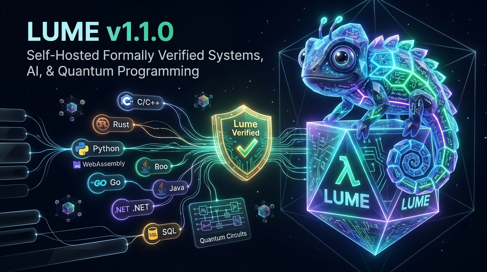

<h1>
  
  Omega Sovereign <code>v1.1.0</code> — 100%-Lume Multimodal AI Workstation &amp; Native Win64 Command Center
</h1>
<br clear="left"/>

<div align="center">

[-10b981?style=for-the-badge)](https://github.com/OmegaSoftDLL/Lume)
[-38bdf8?style=for-the-badge&logo=windows)](https://github.com/OmegaSoftDLL/omega-sovereign/blob/main/OmegaSovereign_GUI.exe)
[](https://github.com/OmegaSoftDLL/omega-sovereign/blob/main/OmegaSovereign_P33.exe)
[](docs/wiki/Chameleon-Polyglot-and-P33.md)
[](docs/wiki/Local-LLM-and-Silicon-Kernels.md)

<br />


<br />



<br />

**[Official Portal](https://omegasoftdll.github.io/omega-sovereign/) · [Wiki Home](docs/wiki/Home.md) · [Win64 GUI Architecture](docs/wiki/Win64-Native-GUI-Architecture.md) · [Local LLM & Silicon Kernels](docs/wiki/Local-LLM-and-Silicon-Kernels.md) · [Chameleon & P33 Shield](docs/wiki/Chameleon-Polyglot-and-P33.md) · [Projects](PROJECTS.md)**

</div>

---

## About `omega-sovereign` · Sobre o `omega-sovereign`

> **EN:** **`omega-sovereign`** is the flagship 100%-Lume Sovereign Multimodal AI Workstation, Native Windows x64 Desktop Command Center (`OmegaSovereign_GUI.exe` & `OmegaSovereign_P33.exe`), and Multi-Target Silicon/GPU Kernel Suite built entirely in **[Lume `v1.1.0`](https://github.com/OmegaSoftDLL/Lume)** — with **zero lines of C, C++, Rust, C#, or Python**. It unifies a standalone `33,792`-byte Windows PE32+ GUI application (`Subsystem 2`), an HTML5/WebAssembly Cockpit (`omega_cockpit.html` + `omega_web_dom.wasm`), a local multimodal LLM router (`Ollama` with `Gemma 4 E2B` & `Ministral 3 3B`), CUDA PTX 8.0 (`omega_ai_kernel.ptx`), Vulkan SPIR-V 1.6 (`omega_ai_kernel.spvasm`), synthesizable IEEE 1364 Verilog RTL (`omega_silicon.v`), a bare-metal real-time kernel (`omega_rtc.kernel`), and the **Universal Chameleon 9-Ecosystem Polyglot Bridge (`[I0003]`)**.
>
> **PT-BR:** O **`omega-sovereign`** e a Estacao de Trabalho Multimodal de IA Soberana e Command Center Desktop Nativo Windows 64-bit (`OmegaSovereign_GUI.exe` e `OmegaSovereign_P33.exe`) construido **100% em [Lume `v1.1.0`](https://github.com/OmegaSoftDLL/Lume)** — com **zero linhas de C, C++, Rust, C# ou Python**. Reune um executavel GUI nativo do Windows de apenas `33.792` bytes (`PE32+ Subsystem 2`), Cockpit Web/WASM (`omega_cockpit.html`), roteamento de LLMs locais (`Ollama` com `Gemma 4 E2B` e `Ministral 3 3B`), kernels GPU CUDA PTX 8.0 e Vulkan SPIR-V 1.6, hardware Verilog RTL (`omega_silicon.v`), kernel de tempo real (`omega_rtc.kernel`) e o **Motor Camaleao Poliglota de 9 Ecossistemas (`[I0003]`)**.

---

## The 6 Sovereign Pillars Integrated in `omega-sovereign`

| Pillar | Subsystem | Source & Emitted Artifact | Formal Proof & Runtime Guarantee |
| :--- | :--- | :--- | :--- |
| **Pillar 1** | **Formal Verification & WCET Prover** | `omega_sovereign.src` -> `omega_sovereign.cert` | `QF_LIA` arithmetic invariants + `@bound(cycles)` WCET + `ML-DSA-65` `.cert` |
| **Pillar 2** | **Perceus Deterministic Memory** | `omega_sovereign.src` (`SRA` + `24B` `Cons`) | Zero GC pause, linear `own` reuse, `0 Bytes` heap leak |
| **Pillar 3** | **Real-Time Bare-Metal Kernel** | `omega_rtc_kernel.src` -> `omega_rtc.kernel` | `[K0005]` symbolic DMA `W^X` protection + `[K0006]` bounded stack |
| **Pillar 4** | **GPU & Silicon Acceleration** | `omega_compute_core.src` -> `.ptx` / `.spvasm` / `.v` | NVIDIA CUDA PTX 8.0 + Vulkan SPIR-V 1.6 + IEEE 1364 Verilog RTL |
| **Pillar 5** | **Native Win64 GUI + Web Cockpit + P33** | `omega_pe64_gui_synth.src` -> `OmegaSovereign_GUI.exe` | `33,792B` PE32+ GUI (`Lumi RT_ICON`, 4 resizable/scrollable panes, P33 `XOR k=178`) |
| **Pillar 6** | **Universal Chameleon 9-Eco Interop** | `omega_sovereign.src` + `lchameleon` | `[I0003]` `unverified[T] -> verified[T]` across C, Rust, Python DLPack, Node, Go, JVM, .NET, SQL, OpenAPI |

---

## Native Win64 PE32+ Desktop Command Center (`OmegaSovereign_GUI.exe`)


Synthesized directly from `omega_pe64_gui_synth.src` in pure Lume without any external C compiler or resource compiler (`rc.exe` / `link.exe`), `OmegaSovereign_GUI.exe` (`33,792` bytes) and `OmegaSovereign_P33.exe` (`33,824` bytes) feature:

- **Embedded Lumi Mascot Icon (`RT_ICON` + `RT_GROUP_ICON`):** `1,128`-byte 32-bit BGRA icon resource loaded via `LoadIconA(hInstance, 1)` directly into `WNDCLASSEXA.hIcon` and `hIconSm`.
- **Clean Modern Studio Layout (`1400x780`):** Top menu bar disabled (`hMenu = 0`) for zero overlap with the 10-button Segoe UI `-12` (`600` semi-bold) quick-action toolbar (`116px–142px` buttons).
- **4 Independently Resizable & Scrollable Panes (`1366px` Full Bottom Span):**
  - **Pane 1 (Left Tree, `LISTBOX`):** Style `1412702209` (`WS_CLIPSIBLINGS | WS_THICKFRAME | WS_HSCROLL | WS_VSCROLL | LBS_DISABLENOSCROLL`) + `LB_SETHORIZONTALEXTENT = 680`.
  - **Pane 2 (Center Code & Dossier Editor, `EDIT`):** Style `1412698308` (`WS_CLIPSIBLINGS | WS_THICKFRAME | WS_HSCROLL | WS_VSCROLL | ES_MULTILINE | ES_AUTOVSCROLL | ES_AUTOHSCROLL | ES_WANTRETURN`).
  - **Pane 3 (Right Proof & Audit Map, `LISTBOX`):** Style `1412702209` + `LB_SETHORIZONTALEXTENT = 680`.
  - **Pane 4 (Bottom 14-Line Telemetry Console, `EDIT`):** Full `1366px` width (`w_raw == 999 -> 1366`) with thick draggable resize borders (`WS_THICKFRAME | WS_CLIPSIBLINGS`) and dual scrollbars.

<br clear="right"/>

---

## Quickstart · Como Executar e Recompilar

### 1. Launch the Native Windows 64-Bit GUI (`OmegaSovereign_GUI.exe`)

```powershell
# Launch the standalone 33,792-byte native Win64 GUI Command Center
Start-Process .\OmegaSovereign_GUI.exe

# Or launch the P33 Anti-REA protected edition (.data encrypted with XOR k=178 + MBA prologue)
Start-Process .\OmegaSovereign_P33.exe
```

### 2. Synthesize & Verify All Artifacts from 100% Lume Source

```bash
# 1. Prove & run the main Omega Sovereign 6-Pillar engine
lume prove omega_sovereign.src
lume test omega_sovereign.src
lume run omega_sovereign.src

# 2. Synthesize OmegaSovereign_GUI.exe (33,792 B) and OmegaSovereign_P33.exe (33,824 B)
lume build omega_pe64_gui_synth.src -o omega_pe64_synth_elf
./omega_pe64_synth_elf
```

---

## Repository Artifact Matrix

| File | Size | Description |
| :--- | :---: | :--- |
| [`omega_sovereign.src`](omega_sovereign.src) | `38.8 KB` | Main 100%-Lume 6-Pillar & Chameleon 9-Ecosystem Sovereign Engine |
| [`omega_pe64_gui_synth.src`](omega_pe64_gui_synth.src) | `43.6 KB` | Pure-Lume Win64 PE32+ GUI & P33 Protected Binary Synthesizer |
| [`OmegaSovereign_GUI.exe`](OmegaSovereign_GUI.exe) | `33,792 B` | Standalone Native Windows x64 GUI Command Center (`Subsystem 2`) |
| [`OmegaSovereign_P33.exe`](OmegaSovereign_P33.exe) | `33,824 B` | P33 Anti-REA Encrypted Native Windows x64 GUI (`XOR k=178` + `LUME_SEAL`) |
| [`omega_cockpit.html`](omega_cockpit.html) | `18.4 KB` | Interactive HTML5 + SVG + WebAssembly Sovereign Telemetry Cockpit |
| [`omega_compute_core.src`](omega_compute_core.src) | `1.9 KB` | Differentiable GPU/Silicon Kernel Source (lowered to `.ptx`, `.spvasm`, `.v`) |
| [`omega_rtc_kernel.src`](omega_rtc_kernel.src) | `1.9 KB` | Real-Time Bare-Metal Control Kernel Source (`[K0005]` / `[K0006]`) |
| [`omega_sovereign.cert`](omega_sovereign.cert) | `34.2 KB` | Cryptographic Formal Proof Certificate (`SHA-256` + `Ed25519` + `ML-DSA-65`) |

---

<div align="center">
  <sub>
    <b>Omega Sovereign v1.1.0</b> · Built 100% in <a href="https://github.com/OmegaSoftDLL/Lume">Lume v1.1.0</a> · Created by <b>Ricardo Bueno (<code>@OmegaSoftDLL</code>)</b> &amp; <b>Omega DeepTech Systems Inc. (ODSI)</b>
  </sub>
</div>
