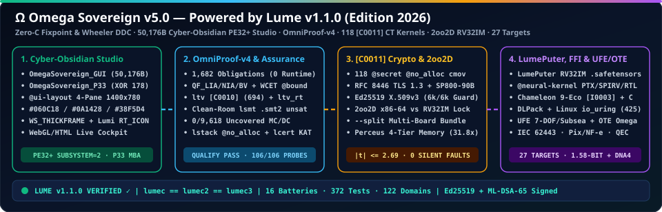

<h1>
  
  Omega Sovereign <code>v5.0</code> — Official Institutional Documentation Portal
</h1>

**Flagship Full-Stack Sovereign Command Center, Binary-Assurance Studio & Multi-Target AI Workstation (`100%` Native Lume `v1.1.0`, Edition 2026)**

 

  

---

## Institutional Overview

**Omega Sovereign (`v5.0`, Edition 2026)** is engineered **100% in pure [Lume `v1.1.0`](https://github.com/OmegaSoftDLL/Lume)** (`Zero C / Zero C++ / Zero Rust / Zero Python / Zero External Linker`). It unifies all **12 Sovereign Architectural Pillars** of Lume `v1.1.0` inside one self-verifying workstation repository:

1. **Zero-C Compiler Fixpoint (`stage2 == stage3`), Wheeler DDC & Direct Win64 `PE32+` Synthesis:** Standalone `50,176`-byte `OmegaSovereign_GUI.exe` and `50,208`-byte P33 MBA-shielded `OmegaSovereign_P33.exe`.
2. **`OmniProof-v4` Multi-Theory Theorem Prover & `lcert --check-source` AST Binding:** `QF_LIA` Farkas duals, `QF_NIA` square-completion, `QF_BV` bit-shifts, octagons, `@bound` WCET (`[V0002]`), `/ pure` (`[E0200]`), and `@no_alloc` (`[E0210]`).
3. **Post-Codegen Symbolic Binary Assurance:** Symbolic translation validation (`ltv` + `[C0010]` machine CT), `18/18` runtime helper verification (`ltv_rt`), clean-room `.smt2` solver (`lsmt`), **`0` uncovered Masking MC/DC conditions** (`lmcdc`), and static worst-case stack byte bounds (`lstack`).
4. **`[C0011]` Constant-Time Cryptography, Ed25519 X.509v3 PKI, NIST SP 800-90B Entropy & Authenticated TLS 1.3.**
5. **`2oo2D` Clean-Room `RV32IM` Safety Envelope (`--split`), 4-Tier Atomic Memory (`31.8×`) & Linear Concurrency (`[E0305]`, `[E0306]`).**
6. **Universal Chameleon 9-Ecosystem Polyglot Interop (`[I0003]`), Built-In C `--preprocess` & Linux `io_uring`.**
7. **`LumePuter` & `LumePU` In-Weights `RV32IM_Zba` `.safetensors` Neural VM & `OpenTPU` Systolic MACs.**
8. **Local Multimodal & 1.58-Bit Sovereign AI (`Bonsai` / `BitNet`, `Gemma 4 E2B`, `Ministral 3 3B`, `Liquid LFM3`, `Colibri` MoE, `VKPromos` CEGIS).**
9. **Cyber-Physical Unified Field (`UFE`), Singularity Boundary $\Omega$ (`OTE`) & IEC 62443 `Omega-Mesh`.**
10. **Sovereign Brazilian FinTech (`SEFAZ NF-e`, `BACEN Pix CobV`, Alphanumeric CNPJ 2026) & `AEGIS` `STIX 2.1` Forensics.**
11. **Frontier `@neural-kernel` Silicon (`CUDA PTX` / `Vulkan SPIR-V` / `Verilog RTL`), `DNA4` Molecular Archival, `OpenQASM 3.0` + `[[9,1,3]]` QEC & Ring-0 Kernel.**
12. **Declarative `@ui-layout` Cyber-Obsidian Win64 Studio, Verified Generic Collections (`Vec`/`Map`/`std_clamp`), 3D Cockpit & Sub-100ms P2P Triad Sentinel.**

---

## Architecture Manuals & Technical Wiki

- **[Main Repository Manual (`EN` & `PT-BR`)](https://github.com/OmegaSoftDLL/omega-sovereign#readme)**
- **[Wiki Home — Architectural Index (`v5.0`)](wiki/Home.html)**
- **[Win64 Native GUI Architecture (`OmegaSovereign_GUI.exe` `50,176 B` & `OmegaSovereign_P33.exe` `50,208 B`)](wiki/Win64-Native-GUI-Architecture.html)**
- **[Local Multimodal LLM Router, `LumePuter` `.safetensors` & Silicon/Quantum Kernels](wiki/Local-LLM-and-Silicon-Kernels.html)**
- **[Universal Chameleon 9-Ecosystem FFI (`[I0003]`), `[C0011]` Crypto, `2oo2D` Lockstep & P33 Shield](wiki/Chameleon-Polyglot-and-P33.html)**
- **[Guia Institucional Completo em Português (`PT-BR`)](wiki/Guia-Completo-PT-BR.html)**
- **[Lume `v1.1.0` Programming Language & Compiler Repository](https://github.com/OmegaSoftDLL/Lume)**
