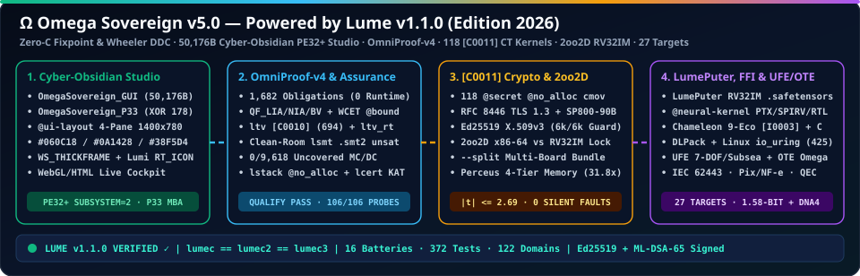

<h1>
  
  Omega Sovereign <code>v1.1.0</code> — Official Wiki Home
</h1>
 

  

---

## Wiki Directory

1. **[Win64 Native GUI Architecture (`OmegaSovereign_GUI.exe`)](Win64-Native-GUI-Architecture)** — Inside `omega_pe64_gui_synth.src`, the `33,792`-byte PE32+ GUI layout, Lumi `RT_ICON` resource table, and 4 resizable/scrollable panes.
2. **[Local Multimodal LLM Router & Silicon Kernels](Local-LLM-and-Silicon-Kernels)** — Orchestrating local `Ollama` (`Gemma 4 E2B` + `Ministral 3 3B`), CUDA PTX 8.0, Vulkan SPIR-V 1.6, and Verilog RTL.
3. **[Universal Chameleon 9-Eco Bridge & P33 Shield](Chameleon-Polyglot-and-P33)** — Pillar 6 `[I0003]` polyglot verification and `OmegaSovereign_P33.exe` (`XOR k=178` + MBA prologue).
4. **[Guia Completo em Portugues (PT-BR)](Guia-Completo-PT-BR)** — Documentacao oficial completa do Omega Sovereign em Portugues.
